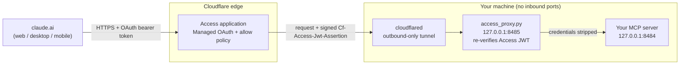

# mcp-access-gateway

Securely expose **any local MCP server** to claude.ai (web, desktop, and mobile) using **Cloudflare Tunnel + Cloudflare Access**, without opening a single inbound port and without writing an OAuth server.

The repo is small on purpose: one ~230-line Python proxy, a self-contained test suite, and Windows scripts that run everything as boot-time background tasks.

## The problem

Many useful MCP servers only run on your own machine: they hold local credentials, read local files, or talk to services that are only reachable from your network. Desktop clients can launch them over stdio, but **claude.ai connectors (and therefore the Claude mobile apps) can only talk to remote servers over HTTPS, and they expect an OAuth login flow.**

Getting there usually means one of these:

- **Port forwarding** opens your home network to the internet and exposes your IP.
- **A quick tunnel with no auth** puts the server one leaked URL away from anyone.
- **Writing your own OAuth authorization server** is a lot of security-critical code to get right.

This project takes a different route: let Cloudflare handle the public edge and the OAuth login, keep the machine outbound-only, and **verify every request again at the origin** so a single misconfiguration doesn't expose the server.

## Architecture



What happens on each request:

1. claude.ai calls `https://tools.example.com/mcp` with an OAuth access token it obtained from Cloudflare Access (Managed OAuth) after you logged in once.
2. Cloudflare Access checks the token and your allow policy. Requests that fail never leave Cloudflare.
3. Access forwards the request through the tunnel and attaches a signed JWT in the `Cf-Access-Jwt-Assertion` header.
4. `cloudflared` on your machine hands it to `access_proxy.py` on localhost.
5. The proxy verifies the JWT itself. Only if it passes does it forward the request to the MCP server, with the auth headers removed. Responses, including Server-Sent Event streams, are streamed back unchanged.

## Security model

Defense in depth: each layer assumes the one in front of it could be misconfigured.

| Layer | What it enforces |
|---|---|
| **Cloudflare Access + Managed OAuth** (edge) | You must log in through your identity provider, and the allow policy must match your email. Access acts as the OAuth authorization server for MCP clients. Dynamic client registration is restricted to claude.ai's two callback URLs, with localhost/loopback redirects off, so another app can't register itself as a client and receive your tokens. |
| **Origin re-verification** (`access_proxy.py`) | Every request must carry a `Cf-Access-Jwt-Assertion` that is **RS256-signed** by your team's Access keys (fetched from `/cdn-cgi/access/certs`), has the right **issuer** (your team domain), the right **audience** (this Access application's AUD tag, so tokens for your other Access apps don't work), is unexpired, and names an email on the proxy's **own allowlist**. Anything else gets `403` and never reaches the MCP server. |
| **Fail-closed config** | Missing config, invalid JSON, an empty allowlist, wildcard emails, or a malformed port/upstream all stop the proxy from starting. It never falls back to "allow". |
| **Localhost-only binding** | The proxy listens on `127.0.0.1` (hard-coded, not configurable) and the MCP server should too. Nothing is reachable from your LAN or the internet except through the tunnel. |
| **Outbound-only tunnel** | `cloudflared` dials out to Cloudflare. No inbound ports, no router changes, and your home IP isn't published in DNS. |
| **Header hygiene** | `Authorization`, `Cookie`, the Access JWT, service-token headers, and `Origin` are stripped before forwarding, so the MCP server never sees edge credentials. `Host` is rewritten to the upstream, which keeps MCP SDK DNS-rebinding protection happy. |

## Repository layout

| File | Purpose |
|---|---|
| `access_proxy.py` | The origin auth proxy (Starlette + httpx + PyJWT). Runs with `uv run --script`, dependencies declared inline. |
| `test_proxy.py` | Self-contained tests with a fake MCP upstream and a throwaway signing key. No network or real server needed. |
| `proxy-config.example.json` | Template for `proxy-config.json` (gitignored). |
| `server-command.example.cmd` | Template for `server-command.cmd` (gitignored): the command that starts your MCP server. |
| `run-proxy.cmd`, `run-server.cmd` | Launchers used by the scheduled tasks. They write to `logs\` with simple size-based rotation. |
| `install-tasks.ps1` | Registers both launchers as boot-time scheduled tasks. |
| `remote-switch.ps1` | Local kill switch: `off`, `on`, `status`. |
| `gateway-ports.ps1` | Helper that reads the ports from your config for the two scripts above. |

`access_proxy.py` is cross-platform. The `.cmd`/`.ps1` wrappers are for Windows; on Linux or macOS, run the same two commands under systemd or launchd instead.

## Configuration

`proxy-config.json` sits next to `access_proxy.py` (or set `GATEWAY_CONFIG` to another path). Each key can be overridden by an environment variable.

| Key | Env var | Default | Meaning |
|---|---|---|---|
| `team_domain` | `ACCESS_TEAM_DOMAIN` | *(required)* | Your Zero Trust team domain, e.g. `<team>.cloudflareaccess.com`. Sets the expected issuer and the key URL. |
| `aud` | `ACCESS_AUD` | *(required)* | The Access application's Application Audience (AUD) tag. |
| `allowed_emails` | `ACCESS_ALLOWED_EMAILS` (comma-separated) | *(required)* | Exact emails allowed through. Case-insensitive, no wildcards. |
| `listen_port` | `GATEWAY_LISTEN_PORT` | `8485` | Port the proxy listens on (always on `127.0.0.1`). |
| `upstream` | `GATEWAY_UPSTREAM` | `http://127.0.0.1:8484` | Base URL of your local MCP server. |
| `log_dir` | `GATEWAY_LOG_DIR` | `logs` | Where `proxy.log` goes. Relative paths are relative to the repo folder. |

None of these values are secrets (Cloudflare's signature is what proves a token), but they describe your deployment, so the real file stays out of git.

The upstream server's launch command lives in `server-command.cmd`. Any MCP server that supports the **streamable HTTP** transport works. Bind it to `127.0.0.1` on the `upstream` port.

## Setup

**Prerequisites:** a Cloudflare account with a domain on Cloudflare DNS (the free Zero Trust plan is enough), [`uv`](https://docs.astral.sh/uv/), `cloudflared`, and an MCP server that speaks streamable HTTP. The steps below use `tools.example.com` as the public hostname.

### 1. Configure the local side

1. Copy `server-command.example.cmd` to `server-command.cmd` and put your server's start command in it.
2. Run it once by hand and confirm the server answers on `http://127.0.0.1:8484`.
3. Run the tests: `uv run --script test_proxy.py` (expect all checks to pass).

### 2. Create the Access application first

Create it **before** anything publishes the hostname. Adding a public hostname to a tunnel creates its DNS record immediately, and if no Access app covers that hostname yet, the proxy would be the only thing between the internet and your server. It would reject everything (no JWT), but you shouldn't rely on a single layer, even briefly.

1. Zero Trust dashboard → **Access → Applications → Add an application → Self-hosted**.
2. Hostname: `tools.example.com`.
3. Add a policy: action **Allow**, include **Emails** = your address. Choose a login method (one-time PIN by email, or a real identity provider with MFA).
4. Turn on **Managed OAuth** (beta) for the application. Restrict dynamic client registration to these redirect URIs only:
   - `https://claude.ai/api/mcp/auth_callback`
   - `https://claude.com/api/mcp/auth_callback`

   Leave **localhost/loopback** redirects **off**.
5. From the app's **Overview**, copy the **Application Audience (AUD) tag**. Note your team domain (`<team>.cloudflareaccess.com`).
6. Copy `proxy-config.example.json` to `proxy-config.json` and fill in `team_domain`, `aud`, and `allowed_emails`.

### 3. Create the tunnel

1. Zero Trust → **Networks → Tunnels → Create a tunnel → Cloudflared**.
2. Install the connector with the command the dashboard shows (`cloudflared service install <token>`, from an elevated shell). It runs as a Windows service and only makes **outbound** connections. Treat the token like a password and never paste it into chats or commit it.
3. Add a **public hostname**: `tools.example.com` → service `HTTP` → `127.0.0.1:8485` (the proxy, **not** the MCP server).
4. Keep the **catch-all rule** as `http_status:404`, so any other hostname routed to this tunnel goes nowhere.
5. In DNS, confirm `tools` is a CNAME to `<tunnel-id>.cfargotunnel.com` and is **Proxied** (orange cloud). A DNS-only record wouldn't pass through Access.

For a locally managed tunnel, the equivalent `config.yml` ingress is:

```yaml
ingress:
  - hostname: tools.example.com
    service: http://127.0.0.1:8485
  - service: http_status:404
```

### 4. Run it at boot

From an **elevated** PowerShell in the repo folder:

```powershell
powershell -ExecutionPolicy Bypass -File .\install-tasks.ps1
```

This registers two scheduled tasks (`\MCP-Gateway\MCP Gateway Server` and `\MCP-Gateway\MCP Gateway Proxy`) that:

- run as **your** user via **S4U** ("run whether user is logged on or not"). Windows doesn't store your password; the trade-off is no access to network shares, which a localhost service doesn't need.
- start at boot, restart on failure, and have a 5-minute watchdog trigger in case restarts run out.

### 5. Verify

1. `curl -i http://127.0.0.1:8485/mcp` → `403` from the proxy (no JWT).
2. `curl -i https://tools.example.com/mcp` → stopped by Access (login redirect or 401/403). The request never reaches your machine.
3. In claude.ai: **Settings → Connectors → Add custom connector** → `https://tools.example.com/mcp` (use your server's MCP path). Connect, log in through Access, and the tools appear. They sync to the Claude mobile and desktop apps.
4. `logs\proxy.log` shows one line per request with the verified email, method, path, and status. Request bodies are never logged.

## Kill switch

- **From anywhere (e.g. your phone):** Zero Trust → Access → Applications → your app → Policies → change the allow policy to **Block**. Or delete the `tools` DNS record, or delete the tunnel's public hostname.
- **On the host (elevated PowerShell):** `.\remote-switch.ps1 off` stops and disables the `cloudflared` service and both tasks and kills anything still listening on the two ports. `.\remote-switch.ps1 on` undoes it, and `status` shows the current state.

## Credential rotation

| Credential | How to rotate |
|---|---|
| **Client sessions / tokens claude.ai holds** | Zero Trust → Access → revoke the user's sessions. Then disconnect and reconnect the connector in claude.ai and log in again. |
| **Tunnel token** | Zero Trust → Networks → Tunnels → your tunnel → rotate the token. Then, in an elevated shell, run `cloudflared service uninstall` and the new `cloudflared service install <token>`. |
| **Access signing keys** | Zero Trust → Settings → rotate the Access keys. The proxy picks up new keys on its own (an unknown key ID triggers a refetch), with no restart. |
| **The MCP server's own credentials** | Follow that server's docs, then restart the "MCP Gateway Server" task. |
| **AUD tag / allowlist changes** | Edit `proxy-config.json` and restart the "MCP Gateway Proxy" task. |

## Design limits & threat model

**Defends against:** anyone on the internet without a login; a leaked hostname; JWTs forged or signed by another key; tokens issued for a different Access application in the same team; expired tokens; and a too-broad Access policy (the origin's own email allowlist still applies).

**Out of scope:** malware already running on the host (it can call the MCP server on localhost directly); a compromised Cloudflare account; vulnerabilities in, or prompt injection through, the MCP server and the data its tools return; and denial of service.

Known limits and trade-offs:

- **Your identity provider's mailbox is the key.** With one-time PIN login, anyone who can read that inbox can request a code. Protect it with strong MFA, or use an identity provider that enforces MFA.
- **The host must be online.** Sleep, reboots, and network drops take the connector offline. Turn off sleep on AC power if you want it always available.
- **Managed OAuth is a beta.** Behavior and settings may change. The MCP authorization spec is moving from Dynamic Client Registration to Client ID Metadata Documents, with DCR deprecated after summer 2027, so expect to revisit the client registration settings.
- **Refresh-grant lifetime is a trade-off.** A long refresh grant means fewer re-logins, but a stolen client token keeps working until the grant expires or you revoke the session. Shorter grants mean more logins. Know where your revoke button is (see Credential rotation).
- **This authenticates *who*, not *what*.** Once a client is connected, it can call every tool the server exposes. MCP clients can auto-approve tools ("Always allow"). Set destructive tools to require approval in the client, or use a server that exposes only what you need.
- **Single-tenant by design.** The allowlist is a handful of exact emails. There's no per-user or per-tool authorization.

## Testing

```bash
uv run --script test_proxy.py
```

The suite starts a fake streamable-HTTP MCP server and the proxy on free localhost ports, and signs tokens with a throwaway RSA key in place of Cloudflare Access. It checks:

- **Rejections (403, never forwarded):** no token, garbage token, wrong signing key, wrong audience, wrong issuer, email not on the allowlist, expired token. It also confirms none of these reached the upstream.
- **Pass-through:** `initialize` with a valid token, MCP session header round-trip, and an SSE-streamed `tools/list`.
- **Header hygiene:** `Authorization`, `Cookie`, `Origin`, and the Access JWT are stripped, and the upstream sees its own `Host`.
- **Upstream down:** a valid token gets `502`, and a missing token still gets `403`.
- **Fail-closed config:** missing file, invalid JSON, missing `aud`, empty allowlist, wildcard email, bad port, non-HTTP upstream. Environment overrides are tested too.

## License

[MIT](LICENSE)
